  

  
  

## About

- I write **C/C++ and Rust**: graphics, physics simulations and native desktop apps.
- On the web side I work with **TypeScript, Vue, Node.js and PHP**.
- I like projects where performance and visuals both matter.

## Projects

  
  

## Stack

  

**Daily** — C/C++, Rust, TypeScript  
**Also** — Vue, Node.js, PHP, Python, C#

## Activity

  
  

